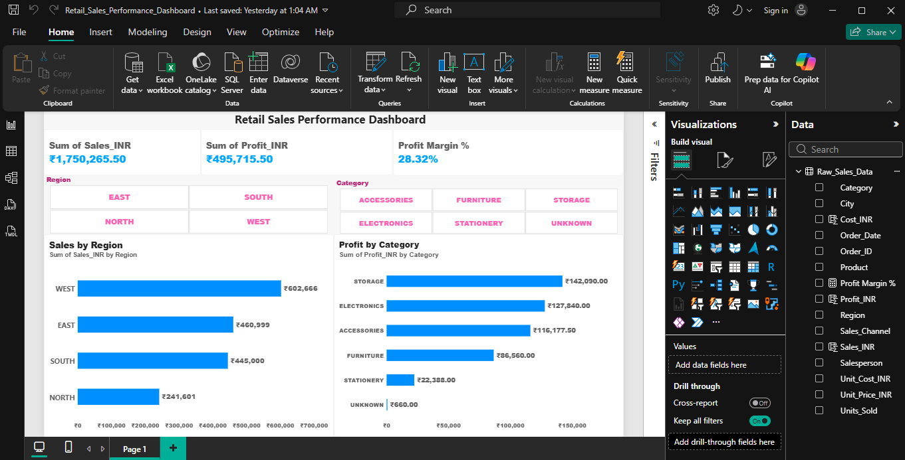

# Retail-sales-performance-dashboard
Interactive Power BI dashboard analyzing retail sales, profit, regional performance, and product category profitability.

## Project Overview
An interactive Power BI dashboard developed to analyze retail sales performance, profitability, regional sales distribution, and product category performance.

## Tools Used
- Microsoft Power BI
- Power Query for data cleaning and transformation
- DAX for calculated measures and KPIs

## Key Performance Indicators
- **Total Sales:** ₹17,50,265.50
- **Total Profit:** ₹4,95,715.50
- **Profit Margin:** 28.32%

## Dashboard Features
- Sales performance analysis by region
- Profitability analysis by product category
- KPI cards for tracking overall business performance
- Category filtering for interactive exploration

## Business Insights
- The dashboard provides a consolidated view of sales and profitability.
- Regional sales comparisons help identify differences in geographic performance.
- Category-level profit analysis helps compare product category contributions.
- The category field includes an `UNKNOWN` value, highlighting a data-quality issue to investigate.

## Dashboard Preview

## Project Files
- `Retail_Sales_Performance_Dashboard.pbix` — Power BI report file
- `retail_sales_dashboard.png` — Dashboard screenshot

## How to View
1. Download the `.pbix` file from this repository.
2. Open it using Microsoft Power BI Desktop.
3. Interact with the charts and filters to explore the results.

## Purpose
This project demonstrates practical skills in business intelligence, data visualization, KPI reporting, and exploratory sales analysis.
